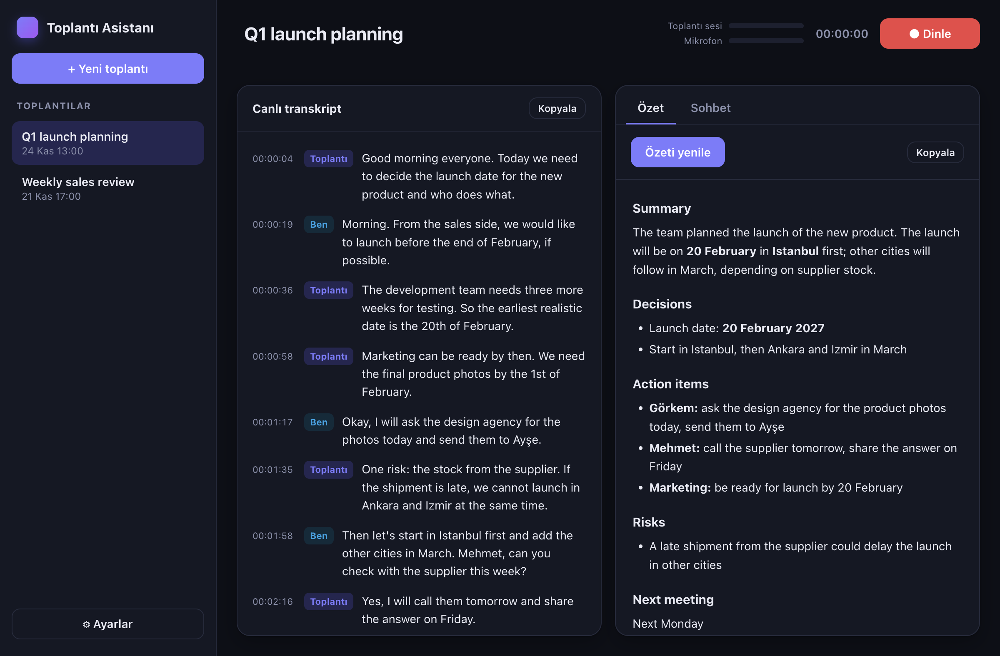
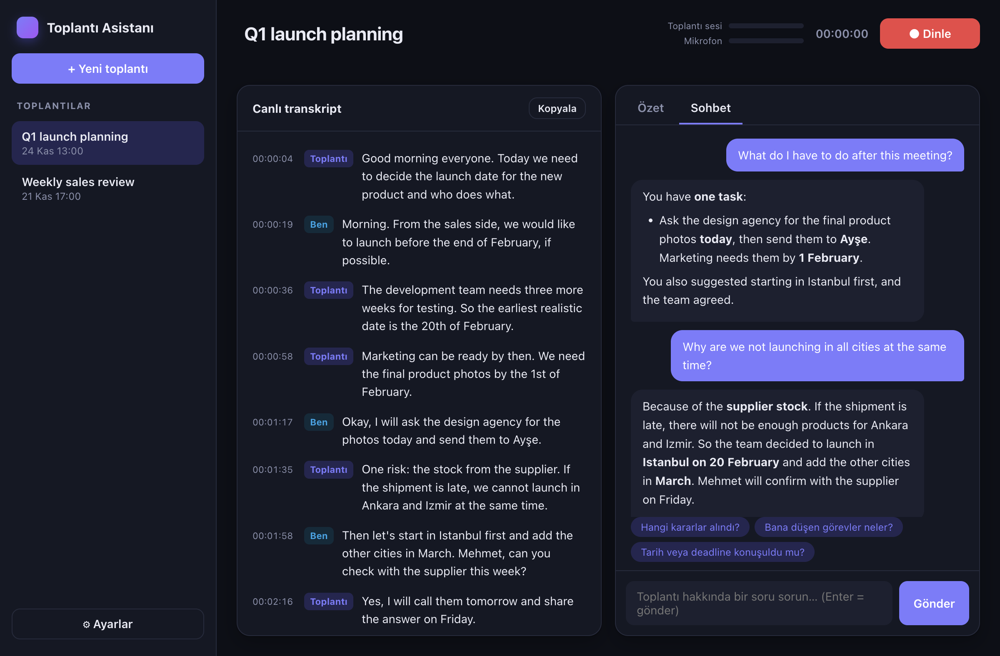
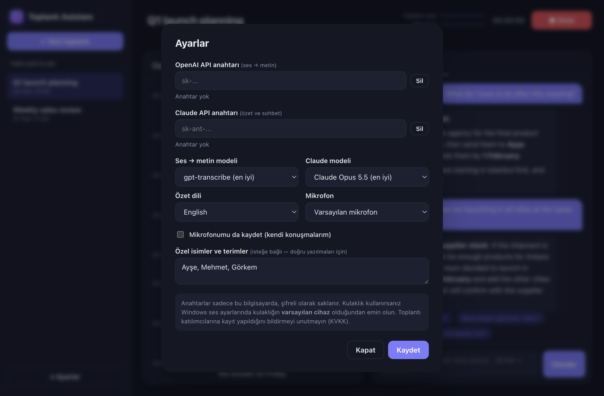

# Meeting Assistant

**A desktop app that listens to online meetings, writes everything down, and gives you a summary and an AI chat about the meeting.**

Built with Electron for **macOS and Windows**. The interface is in Turkish. The app understands meetings that mix **Turkish and English**.

> This repository is a project overview. The source code is private.



## The problem

In many companies, people spend hours in Microsoft Teams meetings. Afterwards, nobody remembers exactly what was decided, who has to do what, or by when. Tools like Microsoft Copilot can help, but not every company has them.

Meeting Assistant solves this with a simple app that runs on the user's own computer.

## What it does

1. **Listens live:** press **Dinle** ("Listen") when the meeting starts. The app records the meeting sound from the computer (the other participants) and, if you want, your microphone (you).
2. **Live transcript:** every 12 to 25 seconds, a piece of audio is turned into text. The transcript appears on screen during the meeting, with a timestamp and the speaker side (*Ben* = me, *Toplantı* = the meeting).
3. **Summary:** one click gives a clear summary with **decisions, action items, risks and the next meeting**.
4. **Chat:** ask questions about the meeting, like *"What do I have to do after this meeting?"*. The AI answers only from what was said.

| Chat about the meeting | Settings |
|---|---|
|  |  |

## How it works

```
Teams sound (loopback) ─┐
                        ├─> audio pieces (12–25 s, cut at a silence)
Microphone (optional) ──┘         │
                                  ▼
                       saved on disk first (nothing is lost)
                                  │
                                  ▼
                  speech-to-text (OpenAI gpt-transcribe)
                                  │
                                  ▼
                 live transcript  ──>  summary + chat (Claude, streamed)
```

## Technical details

- **Electron** app for macOS and Windows, with installers built by electron-builder (`.dmg` and `.exe`).
- **System audio capture:** the meeting sound is recorded with Electron's loopback audio, so it works with Teams, Zoom or any other app, without a bot joining the meeting.
- **Smart audio cutting:** each piece is cut at the first silence after 12 seconds (maximum 25 seconds), so words are not cut in half.
- **No lost audio:** each piece is written to disk before it is sent. If the internet stops or the app crashes, the pieces are sent again on the next start. Failed requests are retried automatically.
- **Mixed languages:** after testing several models, `gpt-transcribe` gave the best results for Turkish speech with English words in the middle. A list of names and terms (set by the user) helps the model spell them correctly.
- **Summary and chat:** made with Anthropic's Claude API. The whole transcript is sent with prompt caching, so follow-up chat questions are fast and cheap. Answers are streamed word by word.
- **Privacy and security:** API keys are encrypted on the computer (Electron `safeStorage`). Meetings are saved only on the user's computer. The app reminds the user to tell participants that the meeting is recorded (KVKK, the Turkish data protection law).
- **Long meetings:** the app stops the computer from sleeping while it is listening.
- **Cost:** less than 1 US dollar for a one-hour meeting.

## Tech stack

`Electron` · `JavaScript` · `Web Audio API / MediaRecorder` · `OpenAI speech-to-text` · `Anthropic Claude API` · `electron-builder`

## Status

Version 0.1.0: working installers for macOS and Windows, used for a demo inside a company.

---

*The meeting in the screenshots is a demo with invented content.*
